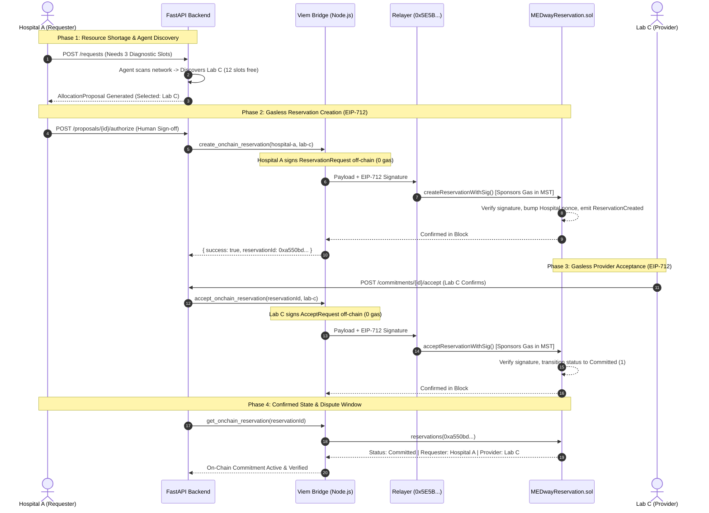
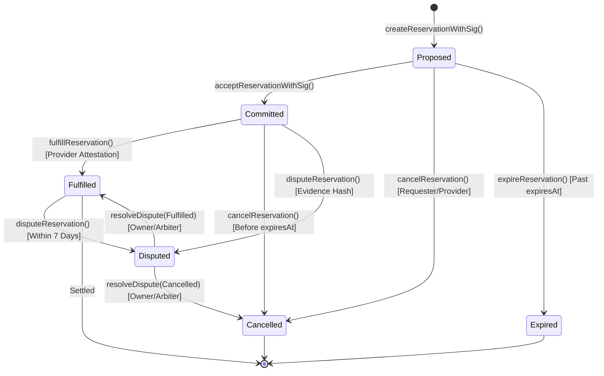

<div align="center">

# MEDSWARM (MEDway)

**Autonomous Healthcare Resource Coordination Platform with EIP-712 Gasless On-Chain Commitments on MST Coral Testnet**

[](https://coralrpc.mstblockchain.com)
[](contracts/contracts/MEDwayReservation.sol)
[](https://fastapi.tiangolo.com/)
[](https://viem.sh)
[](https://react.dev/)
[](contracts/test)
[](LICENSE)

[Overview](#-executive-summary--problem-statement) • [Core Pillars](#-core-architectural-pillars) • [System Architecture](#-system-architecture) • [Live On-Chain Verification](#-live-on-chain-verification-summary) • [Smart Contract](#-smart-contract-specification) • [Getting Started](#-getting-started--local-development) • [Testing](#-testing--verification-suite) • [API Reference](#-api-specification) • [Security & Privacy](#-security-privacy--compliance)

</div>

---

## 🏥 Executive Summary & Problem Statement

In regional healthcare ecosystems, critical diagnostic and surgical facilities—such as MRI scanners, CT suites, dialysis bays, and specialized ICU beds—suffer from severe allocation imbalances. While acute emergency centers face localized surges with patient backlogs, neighboring community hospitals and diagnostic laboratories operate with idle capacity.

```
       [Hospital A]                               [Diagnostic Lab C]
   Surge: 0 Slots Free                        Capacity: 12 Slots Free
   Patient Backlog: HIGH                      Resource Utilization: LOW
            \                                            /
             \--- [ Manual Phone Calls / Chaos ] -------/
                  [ HIPAA / Privacy Restrictions ]
                  [ Incompatible Siloed Systems  ]
```

### The Healthcare Coordination Dilemma
1. **The Privacy & Compliance Barrier (HIPAA)**: Hospitals cannot broadcast patient identities or internal scheduling databases over open networks or public ledgers without violating regulatory compliance.
2. **The Crypto Barrier for Healthcare Staff**: Clinical coordinators, nurses, and hospital administrators cannot be expected to manage cryptocurrency wallets, buy native tokens, or navigate fluctuating gas fees during emergency resource requests.
3. **The Unchecked AI Hazard**: Autonomous AI agents can efficiently discover matching capacity across institutions, but must never commit hospital clinical resources or legal liability without non-repudiable institutional human authorization.
4. **Counterparty Risk & The Double-Booking Trap**: Without a single source of truth, an idle diagnostic slot offered to multiple healthcare centers can be claimed simultaneously, causing dangerous clinical delays.

---

## 💡 The MEDSWARM Solution

**MEDSWARM (MEDway)** is an autonomous healthcare resource coordination platform combining **multi-agent capacity discovery** with **dual-sided EIP-712 relayed meta-transactions on the MST Coral Testnet**:

* **Off-Chain Patient Privacy**: Zero protected health information (PHI) touches the blockchain. Only cryptographic resource references (`resourceRef = keccak256(...)`) and institution addresses are committed on-chain.
* **100% Gasless for Healthcare Institutions**: Hospitals and diagnostic labs sign off-chain EIP-712 authorization payloads using standard private keys with **0 MST native token balance**. A dedicated application relayer submits transactions and pays all gas fees.
* **Human-in-the-Loop Institutional Gate**: Multi-agent algorithms identify optimal allocations across participating centers, but a cryptographically bound on-chain reservation requires authorized institutional sign-off.
* **Tamper-Proof On-Chain Commitments**: The `MEDwayReservation` contract on MST Coral Testnet enforces atomic state transitions (`Proposed` $\rightarrow$ `Committed` $\rightarrow$ `Fulfilled` / `Disputed` / `Expired`), cryptographic signer attribution, nonce-based replay protection, and a 7-day post-delivery dispute window.

---

## 🏛️ Core Architectural Pillars

```
┌─────────────────────────────────────────────────────────────────────────────┐
│                             MEDSWARM CORE PILLARS                           │
├───────────────────────┬──────────────────────────┬──────────────────────────┤
│   ZERO-PII PRIVACY    │    EIP-712 META-TX       │   HUMAN-IN-THE-LOOP      │
│  Patient records stay │ Hospitals pay 0 gas.     │ Agents recommend; human  │
│  strictly off-chain.  │ Relayer sponsors fees    │ coordinators authorize   │
│  Only hashes on-chain │ via Coral Testnet.       │ before on-chain commit.  │
├───────────────────────┼──────────────────────────┼──────────────────────────┤
│  NONCE REPLAY GUARD   │  7-DAY DISPUTE WINDOW    │  DECOUPLED VIEM BRIDGE   │
│  Contract nonces      │ 168-hour arbitration     │ Pure Viem subprocess     │
│  prevent replaying    │ window with on-chain     │ runs without Hardhat     │
│  signed authorizations│ evidence hash tracking.  │ in production backend.   │
└───────────────────────┴──────────────────────────┴──────────────────────────┘
```

1. **Zero Protected Health Information (PHI) On-Chain**  
   Clinical data, patient names, and scheduling metadata remain strictly inside institutional boundaries. Only a 32-byte pseudonymous resource reference hash touches the Coral Testnet ledger.
2. **True Gasless Participation (EIP-712 Relayed Meta-Transactions)**  
   Healthcare institutions never purchase, hold, or manage MST tokens. Institutions sign typed EIP-712 digests off-chain (`ReservationRequest` and `AcceptRequest`). The relayer broadcasts the transactions and pays network fees, while the contract strictly preserves institutional identity (`requester` and `provider`).
3. **Institutional Authorization Gate**  
   Autonomous discovery agents calculate optimal allocations, but cannot finalize commitments independently. A hospital coordinator must explicitly authorize the proposal, triggering cryptographic signing.
4. **Autonomous Expiry & Anti-Stalling Enforcement**  
   Every proposed reservation carries a hard Unix timestamp deadline (`expiresAt`). If a provider does not accept before expiry, any network actor can transition the record to `Expired`, instantly unlocking the slot.
5. **Decoupled Node.js Viem Bridge**  
   A dedicated Python $\leftrightarrow$ Node.js subprocess bridge uses pure Viem without requiring the heavy Hardhat developer runtime or interactive terminal keystores in production.

---

## 📐 System Architecture

MEDSWARM organizes coordination into a clean four-tier architecture:

```mermaid
flowchart TB
    subgraph UI["1. Presentation Tier (React 18 + Vite)"]
        A1["Coordinator Dashboard"] --> A2["Resource Request Wizard"]
        A2 --> A3["Real-Time Capacity Explorer"]
        A3 --> A4["Authorization & Commitment Monitor"]
    end

    subgraph API["2. Orchestration Tier (FastAPI / Python 3.11+)"]
        B1["POST /requests"] --> B2["Autonomous Agent Engine<br/>(agents.py)"]
        B2 --> B3["Constraint Solver & Matcher<br/>(Hospital A -> Lab C)"]
        B3 --> B4["POST /proposals/{id}/authorize<br/>(Human-in-the-Loop Sign-off)"]
    end

    subgraph BRIDGE["3. Blockchain Integration Bridge (Node.js Viem Service)"]
        C1["Python Subprocess Invocation"] --> C2["blockchain-service.js"]
        C2 --> C3["Off-Chain EIP-712 Signing<br/>Hospital A / Lab C Private Keys (0 Gas)"]
        C3 --> C4["Relayer Wallet Client<br/>(CORAL_PRIVATE_KEY)"]
    end

    subgraph CHAIN["4. On-Chain Ledger Tier (MST Coral Testnet - Chain ID 54635)"]
        D1["MEDwayReservation.sol<br/>(0xFc71e5D5b2BD0648BCA20b66a09199E8D89BBEEC)"]
        D2["EIP-712 Signature Verification<br/>(ecrecover + Nonces)"]
        D3["Atomic State Engine<br/>(Proposed -> Committed -> Fulfilled)"]
        D4["7-Day Dispute Window & Resolution"]
    end

    UI -->|HTTP / JSON| API
    API -->|Subprocess / JSON| BRIDGE
    BRIDGE -->|EIP-712 Meta-Transactions| CHAIN
    CHAIN -->|Receipt Logs (parseEventLogs)| BRIDGE
    BRIDGE -->|Confirmed State| API
    API -->|Real-Time Status| UI
```

---

## ⚡ Live On-Chain Verification Summary

The complete end-to-end integration is verified and live on **MST Coral Testnet**.

### Dual-Sided Gasless Lifecycle Sequence



### Confirmed Live Transaction Records

| Parameter | On-Chain Verification Record |
| :--- | :--- |
| **Smart Contract Address** | [`0xFc71e5D5b2BD0648BCA20b66a09199E8D89BBEEC`](https://coralrpc.mstblockchain.com) |
| **Network & Chain ID** | **MST Coral Testnet** (`54635`) |
| **RPC Endpoint** | `https://coralrpc.mstblockchain.com` |
| **Contract Owner** | `0x5E5BB85E3f92389a75e8b555490c99af8B0e8607` |
| **Relayer (Gas Sponsor)** | `0x5E5BB85E3f92389a75e8b555490c99af8B0e8607` (~99.99 MST) |
| **Live Reservation ID** | `0xa550bd19b71e87ff0515504c9bf6d2d03e8a428174772650f8305acab0ac7ccf` |
| **Proposal Creation Tx** | [`0xeb0218194a917781835eb24cf6774b75df9d11e086747dd43ce7c359da5bdafa`](https://coralrpc.mstblockchain.com) |
| **Proposal Block Number** | **Block `#386800`** |
| **Provider Acceptance Tx**| [`0xa1f7f1874faaa9e6558015b7603699cfc4a3c14960636e7c08c4ba9911537b8b`](https://coralrpc.mstblockchain.com) |
| **Acceptance Block Number**| **Block `#386823`** |
| **Hospital A Identity** | `0x4dB8336edB0af7FeD1311312081689993F80a18B` (Gas Paid: **0 MST**) |
| **Lab C Identity** | `0xb05049cc2A5a1c28979DEafc82B82749681DA92C` (Gas Paid: **0 MST**) |
| **Final Confirmed Status** | **`Committed`** (Status Code: `1`) |
| **Dispute Window Window** | **`604,800` seconds (7 days)** |

> **EIP-712 vs. ERC-4337 Note**: MEDSWARM utilizes **EIP-712 relayed meta-transactions**, not ERC-4337 account abstraction. Healthcare institutions participate as standard signers without deploying smart accounts or interacting with bundler mempools. The relayer broadcasts signed payloads, guaranteeing zero gas expenses for healthcare facilities.

---

## 📜 Smart Contract Specification

The core contract [`MEDwayReservation.sol`](contracts/contracts/MEDwayReservation.sol) is compiled with Solidity `0.8.34` using `viaIR: true` and 200 optimizer runs.

### State Machine Lifecycle



### Contract Functions Summary

| Function | Access / Caller | Purpose | Gas Profile |
| :--- | :--- | :--- | :--- |
| `createReservationWithSig(...)` | Public (Relayer) | Creates proposal with EIP-712 requester signature | ~185,000 |
| `acceptReservationWithSig(...)` | Public (Relayer) | Accepts proposal with EIP-712 provider signature | ~42,000 |
| `fulfillReservation(id)` | Provider Only | Attests real-world resource delivery | ~38,000 |
| `cancelReservation(id)` | Requester / Provider | Cancels reservation before expiration | ~34,000 |
| `expireReservation(id)` | Anyone (Keeper) | Flags unaccepted reservation past `expiresAt` | ~31,000 |
| `disputeReservation(id, hash)` | Requester / Provider | Opens dispute with cryptographic evidence hash | ~48,000 |
| `resolveDispute(id, outcome, ...)`| Owner / Arbiter | Resolves active dispute to Fulfilled/Cancelled | ~45,000 |

---

## 📂 Repository Structure

```text
blockchain/
├── backend/
│   ├── app/
│   │   ├── __init__.py
│   │   ├── agents.py             # Multi-agent capacity discovery & constraint matching
│   │   ├── blockchain.py         # Subprocess bridge calling Node.js Viem service
│   │   ├── data.py               # Simulated hospital & lab capacity registries
│   │   ├── main.py               # FastAPI application with REST endpoints
│   │   └── models.py             # Pydantic schemas for requests, proposals & commitments
│   ├── .env                      # Local environment configuration (relayer & institution keys)
│   ├── blockchain-service.js     # Standalone Viem CLI & bridge service (CJS, no Hardhat)
│   ├── check-coral.js            # Raw JSON-RPC diagnostic probe
│   ├── package.json              # Viem & Dotenv dependencies
│   ├── requirements.txt          # FastAPI, Uvicorn, Pydantic dependencies
│   └── verify-contract-state.js  # Direct on-chain bytecode & domain separator verifier
├── contracts/
│   ├── contracts/
│   │   ├── Counter.sol           # Sample starter contract
│   │   ├── Counter.t.sol         # Foundry unit & fuzz test contract
│   │   └── MEDwayReservation.sol # Production EIP-712 coordination smart contract
│   ├── scripts/
│   │   ├── check-coral-signer.ts # Keystore signer verification script
│   │   ├── deploy-medway.ts      # Hardhat deployment script for Coral Testnet
│   │   ├── load-env.ts           # Safe environment & keyloader utility
│   │   ├── relay-coral-reservation.ts # Live sponsored reservation runner
│   │   ├── test-gasless-lifecycle.ts  # End-to-end Hardhat test lifecycle
│   │   └── verify-deployment.ts  # Bytecode and EIP-712 domain verification
│   ├── test/
│   │   ├── Counter.ts            # Counter integration test
│   │   └── MEDwayReservation.ts  # 62-test comprehensive Hardhat + Foundry suite
│   ├── hardhat.config.ts         # Hardhat 3 config with Coral network & viaIR optimizer
│   └── package.json              # Hardhat, Viem, and Toolbox dependencies
├── frontend/
│   ├── src/
│   │   ├── App.tsx               # Reactive coordinator dashboard
│   │   ├── main.tsx              # React DOM entry point
│   │   └── styles.css            # Clean dashboard styles
│   ├── package.json              # Vite & React dependencies
│   └── vite.config.ts            # Vite build configuration
├── .env.example                  # Template configuration for local reproduction
├── .gitignore                    # Prevents secret key leaks
├── LICENSE                       # MIT License
└── README.md                     # Project documentation
```

---

## 🚀 Getting Started & Local Development

### Prerequisites
* **Node.js**: v20.x or v22.x LTS
* **Python**: v3.11 or higher
* **Git**: Installed and configured

---

### Step 1: Clone Repository & Configure Environment
```bash
git clone https://github.com/omkar0075/blockchain.git
cd blockchain

# Copy template to backend/.env and contracts/.env
cp .env.example backend/.env
cp .env.example contracts/.env
```

Your `backend/.env` should contain:
```env
# MST Coral Testnet
CORAL_RPC_URL=https://coralrpc.mstblockchain.com
CHAIN_ID=54635
CONTRACT_ADDRESS=0xFc71e5D5b2BD0648BCA20b66a09199E8D89BBEEC

# Relayer Key (Sponsors Gas on Coral)
CORAL_PRIVATE_KEY=0x...

# Persistent Institution Keys (Off-Chain EIP-712 Signers - 0 MST Needed)
HOSPITAL_A_PRIVATE_KEY=0xdb005ea813f1e7bc63ba1c81cc33b9820502b6a40abfa065b8330fc08f5a607b
HOSPITAL_A_ADDRESS=0x4dB8336edB0af7FeD1311312081689993F80a18B
LAB_C_PRIVATE_KEY=0x857d17464bde4ab400af5f87be5a92388514649da5d39bc6df9d68c85ae71b8c
LAB_C_ADDRESS=0xb05049cc2A5a1c28979DEafc82B82749681DA92C
```

---

### Step 2: Install Dependencies & Verify Blockchain Service
```bash
# 1. Install contract dependencies
cd contracts
npm install

# 2. Install backend Node.js bridge dependencies
cd ../backend
npm install

# 3. Test standalone Viem blockchain service
node blockchain-service.js status
```

Expected output:
```json
{
  "success": true,
  "connected": true,
  "network": "Coral Testnet",
  "chainId": 54635,
  "contractAddress": "0xFc71e5D5b2BD0648BCA20b66a09199E8D89BBEEC",
  "latestBlock": 386825,
  "relayer": {
    "configured": true,
    "address": "0x5E5BB85E3f92389a75e8b555490c99af8B0e8607"
  }
}
```

---

### Step 3: Run the Python FastAPI Backend
```bash
cd backend

# Setup Python Virtual Environment
python -m venv .venv

# Activate Virtual Environment:
# Windows (PowerShell):
.\.venv\Scripts\Activate.ps1
# macOS / Linux:
source .venv/bin/activate

# Install requirements
pip install -r requirements.txt

# Start FastAPI server
uvicorn app.main:app --reload --port 8000
```
API Documentation will be live at: [http://127.0.0.1:8000/docs](http://127.0.0.1:8000/docs)

---

### Step 4: Run the React Frontend Dashboard
```bash
cd frontend
npm install
npm run dev
```
Open [http://localhost:5173](http://localhost:5173) in your browser.

---

## 🧪 Testing & Verification Suite

MEDSWARM includes a **62-test comprehensive test suite** covering unit, fuzzing, authorization, failure recovery, and gasless EIP-712 meta-transactions:

```bash
cd contracts
npx hardhat test
```

### Test Suite Execution Output
```text
Running Solidity tests

  contracts/Counter.t.sol:CounterTest
    ✔ test_InitialValue()
    ✔ test_IncByZero()
    ✔ testFuzz_Inc(uint8) (runs: 256)

Running node:test tests

  MEDwayReservation
    Deployment & Ownership
      ✔ Should set the deployer as owner
      ✔ Should define a 7-day dispute window
    Test 1: Create a reservation
      ✔ Should create a reservation proposal and emit ReservationCreated with correct event args
      ✔ Should accurately store reservation details with status Proposed
      ✔ Should generate unique IDs for separate reservations
    Test 2: Check permissions
      ✔ Should allow the correct provider to accept the reservation
      ✔ Should reject an unrelated account from accepting the reservation
      ✔ Should reject the requester from accepting their own reservation proposal
    Test 3: Check the reservation lifecycle
      ✔ Should complete the full lifecycle: Proposed -> Committed -> Fulfilled
    Test 4: Check expiry
      ✔ Should reject acceptReservation after the expiry deadline has passed
      ✔ Should reject fulfillReservation after the expiry deadline has passed
      ✔ Should reject cancelReservation after expiry deadline has passed
      ✔ Should allow anyone to mark an uncompleted reservation Expired past its deadline
      ✔ Should revert with NotExpired if attempting to expire before deadline
      ✔ Should ensure an expired reservation cannot be accepted
      ✔ Should ensure an expired reservation cannot be fulfilled
    Test 5: Try invalid actions
      ✔ Should reject accepting the same reservation twice
      ✔ Should reject fulfilling a reservation before it is committed
      ✔ Should revert with ReservationNotFound when using an unknown reservation ID
      ✔ Should revert with InvalidAddress if provider is address(0)
      ✔ Should revert with InvalidAddress if requester sets self as provider
      ✔ Should revert with InvalidExpiry if expiresAt is now or in the past
      ✔ Should revert with InvalidEvidence if resourceRef is bytes32(0)
      ✔ Should revert with Unauthorized if non-provider tries to fulfill
      ✔ Should revert with InvalidStatus if fulfilling an already fulfilled reservation
      ✔ Should revert with InvalidStatus if fulfilling a cancelled reservation
    Test 6: Cancellation and disputes
      ✔ Should allow requester to cancel a proposed reservation
      ✔ Should allow provider to cancel a committed reservation before expiry
      ✔ Should allow requester to cancel a committed reservation before expiry
      ✔ Should revert with Unauthorized if third party attempts to cancel
      ✔ Should revert with InvalidStatus if canceling an already fulfilled reservation
      ✔ Should allow requester to dispute a committed reservation with evidence
      ✔ Should allow provider to dispute a fulfilled reservation within the dispute window
      ✔ Should revert with DisputeWindowClosed if disputing a fulfilled reservation after 7 days
      ✔ Should revert with InvalidStatus if disputing a proposed reservation
      ✔ Should revert with InvalidEvidence if evidence hash is bytes32(0)
      ✔ Should revert with Unauthorized if third party attempts to dispute
    Test 7: Dispute Resolution
      ✔ Should allow the owner/arbitrator to resolve a dispute to Fulfilled
      ✔ Should allow the owner/arbitrator to resolve a dispute to Cancelled
      ✔ Should revert with Unauthorized if non-owner attempts to resolve a dispute
      ✔ Should revert with InvalidStatus if attempting to resolve a non-disputed reservation
      ✔ Should revert with InvalidStatus if resolving to an invalid outcome status
      ✔ Should revert with InvalidEvidence if resolution evidence hash is bytes32(0)
    Milestone: Contract Security Checks
      ✔ 1. Unauthorized acceptance: an outsider cannot accept a reservation on behalf of the provider
      ✔ 2. Unauthorized cancellation: an unrelated account cannot cancel a reservation
      ✔ 3. Expiry enforcement: an expired reservation cannot be accepted
      ✔ 4. Invalid state transitions: a fulfilled or cancelled reservation cannot be fulfilled again
      ✔ 5. Dispute behavior: only permitted participants can raise a dispute, and invalid evidence is rejected
    EIP-712 Gasless Meta-Transactions
      ✔ Should allow a relayer to submit createReservationWithSig recording the hospital as requester
      ✔ Should reject createReservationWithSig if the signature is invalid or forged
      ✔ Should reject createReservationWithSig if the deadline has passed
      ✔ Should prevent signature replay attacks using nonces
      ✔ Should allow relayer to submit acceptReservationWithSig on behalf of provider
      ✔ Should decode receipt logs directly using parseEventLogs and verify event arguments
      ✔ Should allow requester to cancel a gasless proposal before expiry
      ✔ Should transition an unaccepted gasless proposal to Expired after deadline passes
      ✔ Should reject acceptReservationWithSig if the reservation has already expired

62 passing (3 solidity, 59 nodejs)
```

---

## 📡 API Specification

| Method | Endpoint | Description | Sample Response / Status |
| :--- | :--- | :--- | :--- |
| `GET` | `/health` | Health check & Coral Testnet connection status | `{ "status": "ok", "blockchain": { "status": "connected", "latest_block": 386825 } }` |
| `GET` | `/institutions` | List participating healthcare centers and resources | `[ { "id": "hospital-a", "name": "City Hospital A" }, ... ]` |
| `POST` | `/requests` | Submit resource shortage; triggers discovery agent | `{ "proposal_id": "...", "selected_provider_id": "lab-c", "status": "proposed" }` |
| `POST` | `/proposals/{id}/authorize` | Human coordinator sign-off; triggers on-chain commit | `{ "status": "authorized", "commitment": { "tx_hash": "0xeb0218...", "block_number": 386800 } }` |
| `POST` | `/commitments/{id}/accept` | Provider EIP-712 acceptance on Coral Testnet | `{ "status": "committed", "blockchain": { "txHash": "0xa1f7f1..." } }` |
| `GET` | `/commitments/{id}/onchain` | Query live Coral contract storage for commitment | `{ "onchain": true, "contract_state": { "status": "Committed", "statusCode": 1 } }` |
| `POST` | `/commitments/{id}/fulfill` | Attest delivery in coordination tracking ledger | `{ "commitment": { "status": "fulfilled" } }` |

---

## 🔒 Security, Privacy & Compliance

### 1. Zero-PII Policy & HIPAA Alignment
* **No Medical Data On-Chain**: Patient names, medical IDs, and procedure details never enter smart contract parameters.
* **Pseudonymous References**: Resources are indexed by 32-byte hash pointers (`resourceRef`), which can only be mapped to clinical details within authorized institutional EHR databases.

### 2. Cryptographic Replay Protection
* The smart contract maintains per-institution replay counters: `mapping(address => uint256) public nonces;`.
* Every signed authorization (`ReservationRequest` / `AcceptRequest`) encodes the signer's current nonce.
* Attempting to replay an identical signature reverts with `InvalidSignature`.

### 3. Signature Expiry Deadlines
* Each signed authorization requires a Unix timestamp `deadline`.
* If network congestion or delays exceed this threshold, the contract reverts with `SignatureExpired`, preventing stale authorizations from executing unexpectedly.

### 4. Dispute Windows & Arbitration
* Once a reservation is fulfilled, a `DISPUTE_WINDOW` of **7 days** (604,800 seconds) is initiated.
* If clinical quality or service delivery fails, either party can raise an on-chain dispute by submitting an immutable `evidenceHash`.
* Designated hospital network arbitrators can adjudicate disputes on-chain via `resolveDispute()`.

---

## 🗺️ Roadmap & Future Enhancements

- [x] Solidity `MEDwayReservation.sol` smart contract with EIP-712 support
- [x] Hardhat 3 configuration and deployment to MST Coral Testnet
- [x] Pure Viem standalone Node.js bridge service
- [x] Python FastAPI integration via subprocess bridge
- [x] Dual-sided gasless lifecycle execution (Hospital A proposal + Lab C acceptance)
- [x] 62-test automated unit, fuzz, and integration testing suite
- [ ] Multi-party threshold signatures (ERC-7739 / Multisig coordination)
- [ ] Zero-Knowledge Proofs (ZK-SNARKs) for anonymous institution credential attestation
- [ ] Push notification dispatchers (Webhook / SMS) for on-call hospital coordinators
- [ ] Production FHIR (Fast Healthcare Interoperability Resources) HL7 EHR connector

---

## 📄 License & Attribution

This project is licensed under the **MIT License** — see the [LICENSE](LICENSE) file for details.

Built with ❤️ for decentralized healthcare resilience and autonomous coordination.
