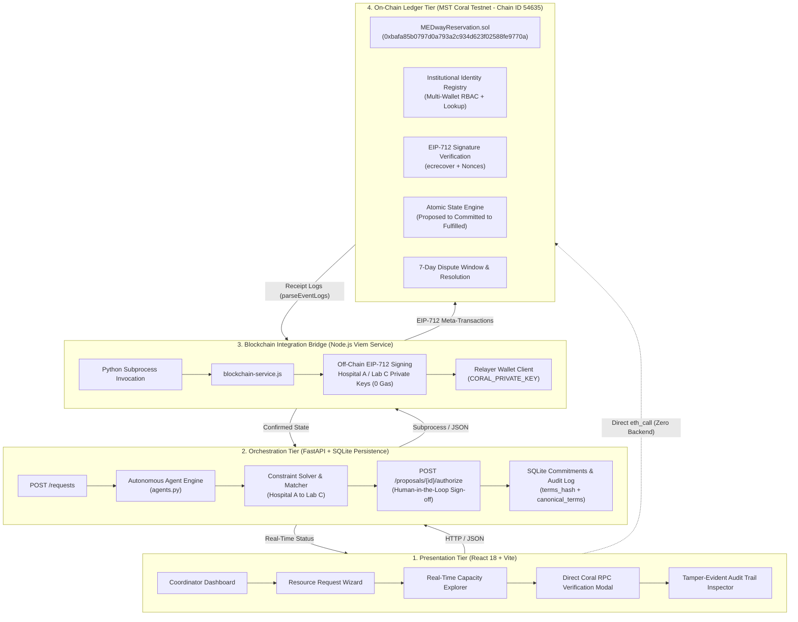
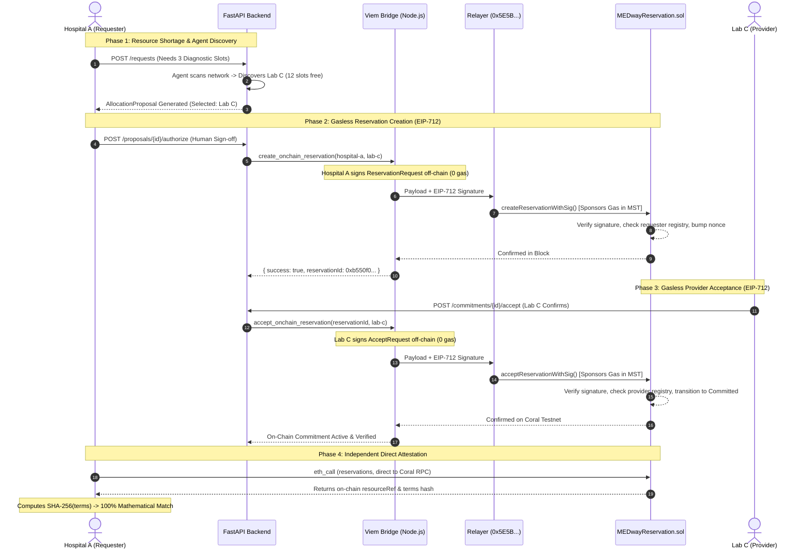
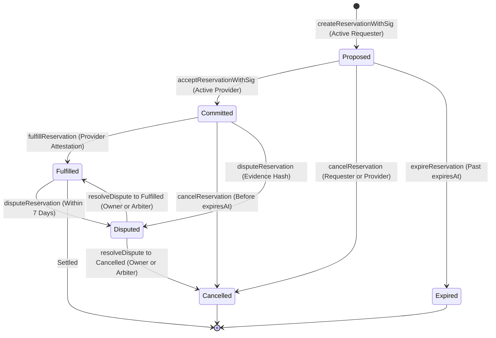
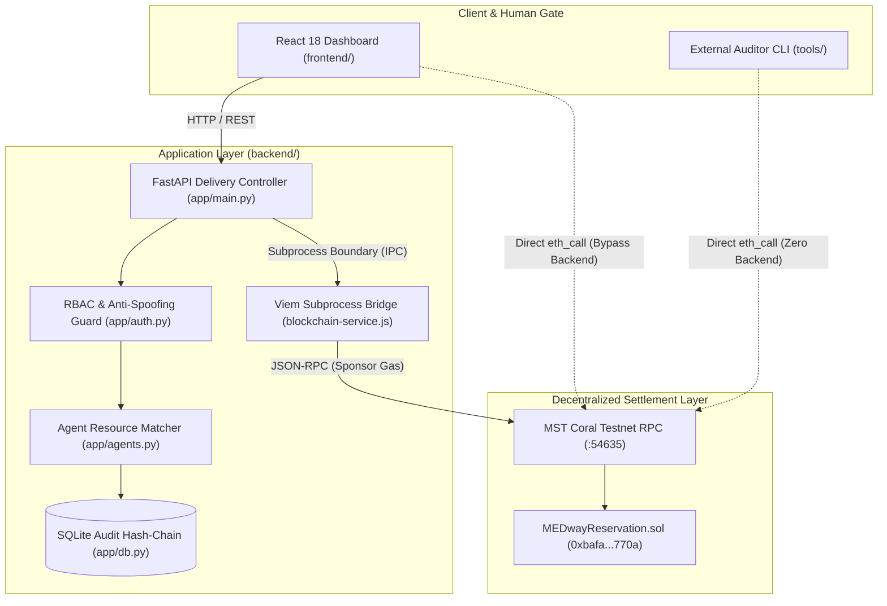

<div align="center">

# MEDway

**Autonomous Healthcare Resource Coordination Platform with EIP-712 Gasless On-Chain Commitments on MST Coral Testnet**

[](https://coralrpc.mstblockchain.com)
[](contracts/contracts/MEDwayReservation.sol)
[](https://fastapi.tiangolo.com/)
[](https://viem.sh)
[](https://react.dev/)
[](contracts/test)
[](backend/test-system-verification.py)
[](LICENSE)

[Overview](#-executive-summary--problem-statement) • [Core Pillars](#-core-architectural-pillars) • [System Architecture](#-system-architecture) • [Live On-Chain Verification](#-live-on-chain-verification-summary) • [Smart Contract](#-smart-contract-specification) • [Getting Started](#-getting-started--local-development) • [Testing & Verification](#-testing--verification-suite) • [Independent Verifier Tool](#-independent-on-chain-terms-verifier-tool) • [API Reference](#-api-specification) • [Security & Privacy](#-security-privacy--compliance)

</div>

---

## 🏥 Executive Summary & Problem Statement

In regional healthcare ecosystems, critical diagnostic and surgical facilities—such as MRI scanners, CT suites, dialysis bays, catheterization labs, and specialized ICU beds—suffer from severe allocation imbalances. While acute emergency centers face localized surges with critical patient backlogs, neighboring community hospitals and diagnostic laboratories operate with idle capacity.

```
       [Hospital A]                               [Diagnostic Lab C]
   Surge: 0 Slots Free                        Capacity: 12 Slots Free
   Patient Backlog: HIGH                      Resource Utilization: LOW
            \                                            /
             \--- [ Manual Phone Calls / Chaos ] -------/
                  [ HIPAA / Privacy Restrictions ]
                  [ Incompatible Siloed Systems  ]
```

### The Healthcare Coordination Dilemma
1. **The Privacy & Compliance Barrier (HIPAA)**: Hospitals cannot broadcast patient identities or internal scheduling databases over open networks or public ledgers without violating regulatory compliance.
2. **The Crypto Barrier for Healthcare Staff**: Clinical coordinators, nurses, and hospital administrators cannot be expected to manage cryptocurrency wallets, buy native tokens, or navigate fluctuating gas fees during emergency resource requests.
3. **The Unchecked AI Hazard**: Autonomous AI agents can efficiently discover matching capacity across institutions, but must never commit hospital clinical resources or legal liability without non-repudiable institutional human authorization.
4. **Counterparty Risk & The Double-Booking Trap**: Without a single source of truth, an idle diagnostic slot offered to multiple healthcare centers can be claimed simultaneously, causing dangerous clinical delays.
5. **Institutional Accreditation & Revocation**: Open smart contracts risk unauthorized parties impersonating hospitals or providers unless rigorous, on-chain institutional identity registries strictly validate participants.

---

## 💡 The MEDway Solution

**MEDway** is an autonomous healthcare resource coordination platform combining **multi-agent capacity discovery** with **dual-sided EIP-712 relayed meta-transactions and on-chain institutional identity verification on the MST Coral Testnet**:

* **Off-Chain Patient Privacy**: Zero protected health information (PHI) touches the blockchain. Only cryptographic resource references (`resourceRef = keccak256(...)`) and institution addresses are committed on-chain.
* **100% Gasless for Healthcare Institutions**: Hospitals and diagnostic labs sign off-chain EIP-712 authorization payloads using standard private keys with **0 MST native token balance**. A dedicated application relayer submits transactions and sponsors all gas fees.
* **Human-in-the-Loop Institutional Gate**: Multi-agent algorithms identify optimal allocations across participating centers, but a cryptographically bound on-chain reservation requires authorized institutional sign-off.
* **On-Chain Institutional Identity Registry**: The smart contract enforces multi-wallet institutional accreditation and role-based access control (`Requester`, `Provider`, or `Both`). Unregistered or revoked wallets are strictly prevented from creating or accepting reservations.
* **Cryptographic Terms Immutability**: Canonical reservation terms are SHA-256 hashed and anchored on-chain upon creation. The contract contains **zero setter functions** to alter terms, guaranteeing that neither party nor the backend can silently modify agreed terms.
* **Tamper-Evident SHA-256 Hash-Chained Audit Trail**: An append-only audit ledger links each operational event to its predecessor's cryptographic digest. Any manual modification or tampering breaks the mathematical hash chain and is immediately flagged.
* **Tamper-Proof On-Chain Commitments**: The `MEDwayReservation` contract on MST Coral Testnet enforces atomic state transitions (`Proposed` $\rightarrow$ `Committed` $\rightarrow$ `Fulfilled` / `Disputed` / `Expired`), cryptographic signer attribution, nonce-based replay protection, and a 7-day post-delivery dispute window.

---

## 🏛️ Core Architectural Pillars

```
┌─────────────────────────────────────────────────────────────────────────────┐
│                              MEDWAY CORE PILLARS                            │
├───────────────────────┬──────────────────────────┬──────────────────────────┤
│   ZERO-PII PRIVACY    │    EIP-712 META-TX       │   HUMAN-IN-THE-LOOP      │
│  Patient records stay │ Hospitals pay 0 gas.     │ Agents recommend; human  │
│  strictly off-chain.  │ Relayer sponsors fees    │ coordinators authorize   │
│  Only hashes on-chain │ via Coral Testnet.       │ before on-chain commit.  │
├───────────────────────┼──────────────────────────┼──────────────────────────┤
│  IDENTITY REGISTRY    │    TERMS IMMUTABILITY    │  TAMPER-EVIDENT AUDIT    │
│  On-chain multi-wallet│ Canonical SHA-256 hash   │ Genesis-to-tip SHA-256   │
│  accreditation & role │ anchored on-chain with   │ hash chain detects any   │
│  enforcement (RBAC).  │ zero mutation setters.   │ database tampering.      │
├───────────────────────┼──────────────────────────┼──────────────────────────┤
│  NONCE REPLAY GUARD   │  7-DAY DISPUTE WINDOW    │  DECOUPLED VIEM BRIDGE   │
│  Contract nonces      │ 168-hour arbitration     │ Pure Viem subprocess     │
│  prevent replaying    │ window with on-chain     │ runs without Hardhat     │
│  signed authorizations│ evidence hash tracking.  │ in production backend.   │
└───────────────────────┴──────────────────────────┴──────────────────────────┘
```

1. **Zero Protected Health Information (PHI) On-Chain**  
   Clinical data, patient names, and scheduling metadata remain strictly inside institutional boundaries. Only a 32-byte pseudonymous resource reference hash touches the Coral Testnet ledger.
2. **True Gasless Participation (EIP-712 Relayed Meta-Transactions)**  
   Healthcare institutions never purchase, hold, or manage MST tokens. Institutions sign typed EIP-712 digests off-chain (`ReservationRequest` and `AcceptRequest`). The relayer broadcasts the transactions and pays network fees, while the contract strictly preserves institutional identity (`requester` and `provider`).
3. **Institutional Authorization Gate**  
   Autonomous discovery agents calculate optimal allocations, but cannot finalize commitments independently. A hospital coordinator must explicitly authorize the proposal, triggering cryptographic signing.
4. **On-Chain Institutional Identity Registry (Feature 2)**  
   Contract owner registers accredited hospitals and facilities with assigned roles (`Requester`, `Provider`, `Both`). Supports multi-wallet authorization and instant revocation with on-chain event emission.
5. **Cryptographic Terms Immutability & Independent Direct Attestation**  
   Canonical reservation terms are stored in SQLite and bound to on-chain `resourceRef`. External verifiers and participating hospitals can verify commitments directly against Coral Testnet via raw `eth_call`, without trusting the MEDway backend.
6. **Tamper-Evident Audit Trail & Off-Chain Evidence Vault**  
   All coordinator actions, sign-offs, and status changes are recorded in an append-only hash-chained ledger. Clinical evidence documents submitted during disputes are independently verifiable via SHA-256 digests.
7. **Autonomous Expiry & Anti-Stalling Enforcement**  
   Every proposed reservation carries a hard Unix timestamp deadline (`expiresAt`). If a provider does not accept before expiry, any network actor can transition the record to `Expired`, instantly unlocking the slot.
8. **Decoupled Node.js Viem Bridge**  
   A dedicated Python $\leftrightarrow$ Node.js subprocess bridge uses pure Viem without requiring the heavy Hardhat developer runtime or interactive terminal keystores in production.

---

## 📐 System Architecture

MEDway organizes coordination into a clean four-tier architecture:



---

## ⚡ Live On-Chain Verification Summary

The complete end-to-end integration is verified and live on **MST Coral Testnet**.

### Dual-Sided Gasless Lifecycle Sequence



### Confirmed Live Transaction Records

| Parameter | On-Chain Verification Record |
| :--- | :--- |
| **Smart Contract Address** | [`0xbafa85b0797d0a793a2c934d623f02588fe9770a`](https://coralrpc.mstblockchain.com) |
| **Network & Chain ID** | **MST Coral Testnet** (`54635`) |
| **RPC Endpoint** | `https://coralrpc.mstblockchain.com` |
| **Contract Owner / Arbiter** | `0x5E5BB85E3f92389a75e8b555490c99af8B0e8607` |
| **Relayer (Gas Sponsor)** | `0x5E5BB85E3f92389a75e8b555490c99af8B0e8607` (~99.97 MST) |
| **Contract Deployment Tx** | [`0xc42915e5b1110b682e48e84900887d817c63aa0b6bb014e99177420778d8b7b8`](https://coralrpc.mstblockchain.com) (Block **#401945**) |
| **Hospital A Registration**| [`0xf8e2c73cc583f108bb2438d3b81888e6ce4974001b4a1255cb24bd273b759420`](https://coralrpc.mstblockchain.com) (Block **#401947**) |
| **Hospital B Registration**| [`0x7e51a9db1c95f74ea87672640f0ec2875dd9d2afedd8f8ffb38b4723d74ae33e`](https://coralrpc.mstblockchain.com) (Block **#401949**) |
| **Lab C Registration** | [`0x7100dd1675583cc192e14f5217934591d13a447555c41b31b05045e10c738d02`](https://coralrpc.mstblockchain.com) (Block **#401952**) |
| **Hospital A Identity** | `0x4dB8336edB0af7FeD1311312081689993F80a18B` (Role: **Requester** · Gas Sponsored: **0 MST Spent**) |
| **Hospital B Identity** | `0x70997970c51812e33987251372ecdbc2b3f3bb6e` (Role: **Requester** · Gas Sponsored: **0 MST Spent**) |
| **Lab C Identity** | `0xb05049cc2A5a1c28979DEafc82B82749681DA92C` (Role: **Provider** · Gas Sponsored: **0 MST Spent**) |
| **Complete State Lifecycle**| **`Proposed` $\rightarrow$ `Committed` $\rightarrow$ `Fulfilled` $\rightarrow$ `Disputed` $\rightarrow$ `Cancelled` (Resolved)** |
| **Dispute Window Window** | **`604,800` seconds (7 days)** |

> **EIP-712 vs. ERC-4337 Note**: MEDway utilizes **EIP-712 relayed meta-transactions**, not ERC-4337 account abstraction. Healthcare institutions participate as standard signers without deploying smart accounts or interacting with bundler mempools. The relayer broadcasts signed payloads, guaranteeing zero gas expenses for healthcare facilities.

---

## 📜 Smart Contract Specification

The core contract [`MEDwayReservation.sol`](contracts/contracts/MEDwayReservation.sol) is compiled with Solidity `0.8.34` using `viaIR: true` and 200 optimizer runs.

### State Machine Lifecycle



### Contract Functions Summary

| Function | Access / Caller | Purpose | Gas Profile |
| :--- | :--- | :--- | :--- |
| `registerInstitution(id, name, role)` | Contract Owner | Registers accredited healthcare center with role | ~98,000 |
| `authorizeWallet(id, wallet)` | Contract Owner | Authorizes additional wallet for registered institution | ~45,000 |
| `revokeWallet(wallet)` | Contract Owner | Revokes individual institutional wallet access | ~28,000 |
| `setInstitutionActive(id, active)` | Contract Owner | Pauses or re-activates entire institution | ~30,000 |
| `setInstitutionRole(id, newRole)` | Contract Owner | Updates accredited institutional role with event | ~32,000 |
| `rotateReservationWallet(id, new)` | Institution / Owner | Key rotation on active commitment without disruption | ~36,000 |
| `addArbitrator(wallet)` | Contract Owner | Appoints member to Consortium Arbitration Board | ~46,000 |
| `removeArbitrator(wallet)` | Contract Owner | Removes member while enforcing quorum safety | ~29,000 |
| `setArbitrationQuorum(quorum)` | Contract Owner | Configures multi-party arbitration voting threshold | ~28,000 |
| `castArbitrationVote(id, ruling, ...)`| Board Arbitrator | Multi-party dispute vote; auto-finalizes at quorum | ~52,000 |
| `getDisputeRuling(id)` | Public View | View dispute vote tallies and resolution status | Free (0 gas) |
| `getInstitutionByWallet(wallet)` | Public View | Look up institution ID, name, role, and active status | Free (0 gas) |
| `isRequesterWallet(wallet)` | Public View | Checks if wallet is accredited active requester | Free (0 gas) |
| `isProviderWallet(wallet)` | Public View | Checks if wallet is accredited active provider | Free (0 gas) |
| `createReservationWithSig(...)` | Public (Relayer) | Creates proposal with EIP-712 requester signature | ~185,000 |
| `acceptReservationWithSig(...)` | Public (Relayer) | Accepts proposal with EIP-712 provider signature | ~42,000 |
| `fulfillReservation(id)` | Provider Wallet | Attests real-world resource delivery (resilient) | ~38,000 |
| `cancelReservation(id)` | Requester / Provider | Cancels reservation before expiration | ~34,000 |
| `expireReservation(id)` | Anyone (Keeper) | Flags unaccepted reservation past `expiresAt` | ~31,000 |
| `disputeReservation(id, hash)` | Requester / Provider | Opens dispute with cryptographic evidence hash | ~48,000 |
| `resolveDispute(id, outcome, ...)`| Arbiter (Quorum=1) | Resolves active dispute when quorum is 1 | ~45,000 |

---

## 📂 Repository Structure & Clean Architectural Boundaries

MEDway is structured as a monorepo adhering strictly to **Clean Architecture** principles and explicit separation of concerns. The codebase is partitioned into distinct architectural layers with strict unidirectional dependency boundaries:

```
┌─────────────────────────────────────────────────────────────────────────────────┐
│                          CLEAN ARCHITECTURAL BOUNDARIES                         │
├────────────────────────────────┬────────────────────────────────────────────────┤
│ 1. SETTLEMENT LAYER            │ EVM smart contracts on MST Coral Testnet.      │
│    (contracts/)                │ Zero PHI on-chain, EIP-712 meta-transactions,  │
│                                │ Identity Registry RBAC & Consortium Board.     │
├────────────────────────────────┼────────────────────────────────────────────────┤
│ 2. APPLICATION ORCHESTRATION   │ FastAPI microservices & multi-agent matching.  │
│    (backend/app/)              │ Domain models decoupled from blockchain logic, │
│                                │ SQLite persistence & SHA-256 audit hash-chain. │
├────────────────────────────────┼────────────────────────────────────────────────┤
│ 3. DECOUPLED WEB3 BRIDGE       │ Isolated Node.js Viem subprocess bridge.       │
│    (backend/blockchain-service)│ Shields FastAPI async loop from RPC latency,   │
│                                │ gas sponsorship & EIP-712 signature digestion. │
├────────────────────────────────┼────────────────────────────────────────────────┤
│ 4. PRESENTATION & VERIFICATION │ React 18 coordinator dashboard with human gate │
│    (frontend/)                 │ and direct browser-to-Coral RPC verification.  │
├────────────────────────────────┼────────────────────────────────────────────────┤
│ 5. INDEPENDENT AUDIT HARNESS   │ Standalone zero-backend verification CLI tool  │
│    (tools/verify-onchain.js)   │ reading raw EVM storage slots via eth_call.    │
└────────────────────────────────┴────────────────────────────────────────────────┘
```

### Architectural Dependency Flow



### Monorepo Directory Layout

```text
blockchain/
├── 📁 backend/                             # Layer 2 & 3: Application Orchestration & Web3 Bridge
│   ├── 📁 app/                             # Core Python application domain
│   │   ├── __init__.py                     # Package boundary declaration
│   │   ├── agents.py                       # Pure domain: multi-agent capacity discovery & offer ranking
│   │   ├── auth.py                         # Security boundary: RBAC, API credential guard & anti-spoofing
│   │   ├── blockchain.py                   # IPC adapter: calls Node.js bridge across clean process boundary
│   │   ├── data.py                         # Seed data: initial hospital & diagnostic facility capacity
│   │   ├── db.py                           # Persistence boundary: SQLite engine & SHA-256 hash-chained audit
│   │   ├── main.py                         # Delivery boundary: REST API endpoints with Pydantic validation
│   │   └── models.py                       # Clean domain entities: request, proposal, commitment schemas
│   ├── 📁 data/                            # Local database persistence volume
│   │   └── medway.db                       # Append-only SQLite database file
│   ├── blockchain-service.js               # Standalone Viem bridge script (CJS, no Hardhat runtime in prod)
│   ├── check-coral.js                      # Diagnostic probe: tests RPC latency, block height & node health
│   ├── verify-contract-state.js            # Diagnostic probe: inspects on-chain reservation & registry mappings
│   ├── test-system-verification.py         # 8-module end-to-end system verification harness
│   ├── test_api_endpoints.py               # REST API test suite (HTTP status codes, RBAC & anti-spoofing)
│   ├── requirements.txt                    # Python environment dependencies (FastAPI, Uvicorn, HTTPX)
│   ├── package.json                        # Node.js dependencies for Viem bridge (viem, dotenv)
│   └── .env                                # Local environment secrets (relayer & institution private keys)
│
├── 📁 contracts/                           # Layer 1: Settlement & Consensus Layer (Solidity / Hardhat 3)
│   ├── 📁 contracts/                       # Smart contract domain source code
│   │   ├── MEDwayReservation.sol          # Primary contract: EIP-712 meta-tx, Identity Registry, Arbitration
│   │   ├── Counter.sol                     # Reference sample contract
│   │   └── Counter.t.sol                   # Foundry unit & fuzz test contract (Solidity tests)
│   ├── 📁 scripts/                         # Operational deployment & interaction runners
│   │   ├── deploy-upgraded-coral.cjs       # Production deployer & initial institution accreditation runner
│   │   ├── deploy-medway.ts                # TypeScript deployment script
│   │   ├── verify-deployment.ts            # Bytecode verification & EIP-712 domain separator validation
│   │   ├── verify-medway.ts                # Live on-chain status inspection script
│   │   ├── check-coral.ts                  # Coral RPC endpoint reachability verifier
│   │   ├── check-coral-signer.ts           # Relayer keystore address & native MST balance verifier
│   │   ├── relay-coral-reservation.ts      # Live sponsored gasless reservation execution runner
│   │   ├── relay-reservation.ts            # Generic relayer submission runner
│   │   ├── create-reservation.ts           # Direct reservation proposal creation script
│   │   ├── accept-reservation.ts           # Direct provider reservation acceptance script
│   │   ├── fulfill-reservation.ts          # Direct provider fulfillment attestation script
│   │   ├── test-gasless-lifecycle.ts       # End-to-end gasless simulation lifecycle runner
│   │   ├── test-security-suite.ts          # Standalone adversarial security verification script
│   │   ├── test-unauthorized-fulfill.ts    # Unauthorized third-party fulfillment rejection script
│   │   └── load-env.ts                     # Multi-environment configuration & key loader utility
│   ├── 📁 test/                            # Hardhat test suite specifications
│   │   ├── MEDwayReservation.ts           # 95-test comprehensive Hardhat suite (Node.js + Foundry viaIR)
│   │   └── Counter.ts                      # Counter integration test
│   ├── 📁 ignition/modules/                # Hardhat Ignition deployment configurations
│   │   └── Counter.ts                      # Deployment module for Counter
│   ├── hardhat.config.ts                   # Hardhat 3 config (Solidity 0.8.34, viaIR, Coral Testnet target)
│   ├── tsconfig.json                       # TypeScript compiler configuration for contract tooling
│   └── package.json                        # Development dependencies (Hardhat, Viem, Toolbox, Types)
│
├── 📁 frontend/                            # Layer 4: Presentation & Client-Side Verification Layer
│   ├── 📁 src/                             # UI application source code
│   │   ├── App.tsx                         # Coordinator dashboard with Direct RPC Verify widget
│   │   ├── main.tsx                        # React DOM root entry point
│   │   └── styles.css                      # Modern responsive healthcare UI design system
│   ├── index.html                          # Single-page application HTML entry
│   ├── vite.config.ts                      # Vite build configuration & development proxy settings
│   ├── tsconfig.json                       # TypeScript compiler options for React JSX
│   └── package.json                        # Frontend dependencies (React 18, Vite, Lucide Icons)
│
├── 📁 tools/                               # Layer 5: Independent Trustless Attestation Layer
│   └── verify-onchain.js                   # Zero-backend auditor CLI (reads raw EVM storage slots via eth_call)
│
├── .env.example                            # Comprehensive environment variables template
├── .gitignore                              # Git exclusion rules (secrets, venvs, artifacts & node_modules)
├── LICENSE                                 # MIT Open Source License
└── README.md                               # Complete project documentation, architecture & runbooks
```

---

## 🚀 Getting Started & Local Development

### Prerequisites
* **Node.js**: v20.x or v22.x LTS
* **Python**: v3.11 or higher
* **Git**: Installed and configured

---

### Step 1: Clone Repository & Configure Environment
```bash
git clone https://github.com/omkar0075/blockchain.git
cd blockchain

# Copy template to backend/.env and contracts/.env
cp .env.example backend/.env
cp .env.example contracts/.env
```

Your `backend/.env` should contain:
```env
# MST Coral Testnet
CORAL_RPC_URL=https://coralrpc.mstblockchain.com
CHAIN_ID=54635
CONTRACT_ADDRESS=0xbafa85b0797d0a793a2c934d623f02588fe9770a
MEDWAY_CONTRACT_ADDRESS=0xbafa85b0797d0a793a2c934d623f02588fe9770a

# Relayer Key (Sponsors Gas on Coral)
CORAL_PRIVATE_KEY=0x...

# Persistent Institution Keys (Off-Chain EIP-712 Signers - 0 MST Needed)
HOSPITAL_A_PRIVATE_KEY=0xdb005ea813f1e7bc63ba1c81cc33b9820502b6a40abfa065b8330fc08f5a607b
HOSPITAL_A_ADDRESS=0x4dB8336edB0af7FeD1311312081689993F80a18B
LAB_C_PRIVATE_KEY=0x857d17464bde4ab400af5f87be5a92388514649da5d39bc6df9d68c85ae71b8c
LAB_C_ADDRESS=0xb05049cc2A5a1c28979DEafc82B82749681DA92C
```

---

### Step 2: Install Dependencies & Verify Blockchain Service
```bash
# 1. Install contract dependencies
cd contracts
npm install

# 2. Install backend Node.js bridge dependencies
cd ../backend
npm install

# 3. Test standalone Viem blockchain service
node blockchain-service.js status
```

Expected output:
```json
{
  "success": true,
  "connected": true,
  "network": "Coral Testnet",
  "chainId": 54635,
  "contractAddress": "0xbafa85b0797d0a793a2c934d623f02588fe9770a",
  "latestBlock": 402066,
  "contractOwner": "0x5E5BB85E3f92389a75e8b555490c99af8B0e8607",
  "relayer": {
    "configured": true,
    "address": "0x5E5BB85E3f92389a75e8b555490c99af8B0e8607"
  }
}
```

---

### Step 3: Run the Python FastAPI Backend
```bash
cd backend

# Setup Python Virtual Environment
python -m venv .venv

# Activate Virtual Environment:
# Windows (PowerShell):
.\.venv\Scripts\Activate.ps1
# macOS / Linux:
source .venv/bin/activate

# Install requirements
pip install -r requirements.txt

# Start FastAPI server
uvicorn app.main:app --reload --port 8000
```
API Documentation will be live at: [http://127.0.0.1:8000/docs](http://127.0.0.1:8000/docs)

---

### Step 4: Run the React Frontend Dashboard
```bash
cd frontend
npm install
npm run dev
```
Open [http://localhost:5173](http://localhost:5173) in your browser.

---

## 🧪 Testing & Verification Suite

MEDway includes two comprehensive test suites:

### 1. Smart Contract Test Suite (`95/95 Passing`)
Covers deployment, ownership, lifecycle transitions, authorization, expiry, dispute handling, gasless EIP-712 meta-transactions, on-chain Institutional Identity Registry, adversarial security controls, and Consortium Arbitration Board governance:

```bash
cd contracts
npx hardhat test
```

Execution Summary:
```text
Running Solidity tests
  contracts/Counter.t.sol:CounterTest
    ✔ test_InitialValue()
    ✔ test_IncByZero()
    ✔ testFuzz_Inc(uint8) (runs: 256)

Running node:test tests
  Counter
    ✔ Should emit the Increment event when calling the inc() function
    ✔ The sum of the Increment events should match the current value

  MEDwayReservation
    Deployment & Ownership (2 tests)
    Test 1: Create a reservation (3 tests)
    Test 2: Check permissions (3 tests)
    Test 3: Check the reservation lifecycle (1 test)
    Test 4: Check expiry (7 tests)
    Test 5: Try invalid actions (10 tests)
    Test 6: Cancellation and disputes (11 tests)
    Test 7: Dispute Resolution (6 tests)
    Milestone: Contract Security Checks (5 tests)
    EIP-712 Gasless Meta-Transactions (9 tests)
    Institutional Identity Registry - Feature 2 (14 tests)
    Feature 2: Adversarial Multi-Party Authorization & Security Checks (13 tests)
    Consortium Arbitration Board - Governance Item D (6 tests)

95 passing (3 solidity, 92 nodejs)
```

---

### 2. End-to-End System Verification Suite (`8/8 Passing`)
Verifies persistence across process boundaries, RBAC authorization, arbitration alignment, clinical evidence integrity, audit hash-chain tamper detection, live Coral Testnet storage, and cryptographic terms immutability:

```bash
python backend/test-system-verification.py
```

Output:
```text
=================================================================
 MEDway COMPREHENSIVE SYSTEM VERIFICATION SUITE
=================================================================

 TEST 1: SQLite Persistence & Process Boundary Recovery
  [+] Saved commitment to SQLite DB.
  [+] Successfully recovered commitment from fresh DB connection.
  [+] Terms Hash: 0x03cf150c8c1358... | Canonical Terms Restored: quantity=3
  RESULT: PASSED (Data survives across connections)

 TEST 2: Authentication & RBAC Enforcement
  [+] Correctly rejected invalid API key: HTTP 401
  [+] Successfully authenticated: City Hospital A (Role: requester)
  [+] Correctly rejected cross-hospital authorization: HTTP 403
  [+] Correctly blocked non-arbitrator from arbitration: HTTP 403
  RESULT: PASSED (All RBAC permission guards verified)

 TEST 3: Arbitration Alignment with On-Chain Contract Owner
  [+] Live Coral Contract Address: 0xbafa85b0797d0a793a2c934d623f02588fe9770a
  [+] Live On-Chain Contract Owner: 0x5E5BB85E3f92389a75e8b555490c99af8B0e8607
  [+] Backend Arbitrator Identity: 0x5E5BB85E3f92389a75e8b555490c99af8B0e8607
  [+] Alignment check: 100% MATCH (No divergence possible)
  RESULT: PASSED (Backend arbitrator strictly matches on-chain owner)

 TEST 4: Evidence Integrity & Independent SHA-256 Recomputation
  [+] Stored SHA-256 Digest:       0x467150e5619fb7652849218fcaf6b0eca6b7e26495a5a6dfe5d044b878fca6bc
  [+] Independently Recomputed:    0x467150e5619fb7652849218fcaf6b0eca6b7e26495a5a6dfe5d044b878fca6bc
  [+] Integrity Verification:      VERIFIED
  RESULT: PASSED (Exact document retrieved and hash verified)

 TEST 5: Audit Hash-Chain Verification & Tamper Detection
  [+] Baseline Audit Trail Check:  Valid=True (Total Records: 19)
  [+] Appended New Block:          Valid=True (Total Records: 20)
  [!] Artificially tampered record ID #20 in SQLite DB.
  [+] TAMPER DETECTED: At row ID #20
  [+] Restored original record ID #20: Valid=True
  RESULT: PASSED (Mathematical hash-chain detects any tampering)

 TEST 6: On-Chain Institutional Identity Registry Verification
  [+] Hospital A On-Chain Registry:   Active=True | Role=Requester (City Hospital A)
  [+] Lab C On-Chain Registry:        Active=True | Role=Provider (Central Diagnostic Lab C)
  [+] Unregistered Wallet (0x11111111...): Active=False | Role=None
  RESULT: PASSED (Institutional Identity Registry enforced on Coral Testnet)

 TEST 7: Live Backend Workflow -> SQLite -> Direct Coral Verification
  [+] Live Multi-Agent Match: Hospital A -> Lab C (Proposal: 169e4670...)
  [+] Live Commitment Created: ID: 9f960fd4... | On-Chain: 0xb550f09d...
  [+] Direct Coral Node Verification:
      - On-Chain Requester:   0x4db8336edb0af7fed1311312081689993f80a18b
      - On-Chain Provider:    0xb05049cc2a5a1c28979deafc82b82749681da92c
      - On-Chain resourceRef: 0xe0e807584b6714babc32330a84dfe306517bb3d276580bbfe55e09e69070e360
      - Recomputed SHA-256:   0xe0e807584b6714babc32330a84dfe306517bb3d276580bbfe55e09e69070e360
      - Attestation Result:   100% MATHEMATICAL MATCH
  [+] Tamper Detection on Live Pair: Quantity changed 3 -> 99 diverges hash
  RESULT: PASSED (Exact SQLite commitment verified against Coral Testnet storage)

 TEST 8: Independent Direct RPC Verification & Immutability Attestation
  [+] Zero-Backend RPC Query: Successful to https://coralrpc.mstblockchain.com
  [+] Decoded On-Chain Requester: 0x4db8336edb0af7fed1311312081689993f80a18b
  [+] Decoded On-Chain Provider:  0xb05049cc2a5a1c28979deafc82b82749681da92c
  [+] Decoded On-Chain Status:    0 (Proposed)
  [+] Decoded resourceRef:        0xe0e807584b6714babc32330a84dfe306517bb3d276580bbfe55e09e69070e360
  [+] Canonical Terms Hash: 0x03cf150c8c1358b8e1f2d2b74446b5955e5e596943ca62f722cb8d969dcb3d12
  [!] Tampered Terms Hash:  0xdc383728a386e8d061458c364d148eb4b898483d706784a09282350545110b8a
  [+] Mathematical Proof: Silent modification is immediately exposed because digest diverges.
  RESULT: PASSED (Independent direct verification and terms immutability confirmed)

=================================================================
 ALL 8 VERIFICATION TEST MODULES PASSED SUCCESSFULLY!
=================================================================
```

---

### 3. FastAPI REST API Endpoint Test Suite (`8/8 Passing`)
Tests end-to-end HTTP request handling, RBAC header authentication, invalid API key rejection, and anti-spoofing guards:

```bash
python backend/test_api_endpoints.py
```

Output:
```text
Testing FastAPI REST API Endpoints...
  [+] GET /health -> 200 OK (Contract: 0xbafa85b0797d0a793a2c934d623f02588fe9770a)
  [+] GET /institutions -> 200 OK (3 accredited institutions)
  [+] GET /institutions/hospital-a/onchain -> 200 OK (City Hospital A | Role: Requester)
  [+] GET /audit/verify -> 200 OK (Hash-chain Valid: True, Records: 35)
  [+] GET /audit -> 200 OK (35 audit records in log)
  [+] POST /requests with invalid API key correctly rejected -> 401 Unauthorized
  [+] POST /requests with spoofed institution ID correctly rejected -> 403 Forbidden
  [+] POST /requests with Hospital A credentials -> 200 OK (Selected Provider: lab-c)
  [+] GET /commitments -> 200 OK (Commitments retrieved successfully)

ALL FASTAPI REST ENDPOINTS PASSED VERIFICATION!
```

---

## 🔍 Independent On-Chain Terms Verifier Tool

Participating institutions and auditors can verify reservation commitments directly from Coral Testnet using the zero-backend standalone CLI tool [`tools/verify-onchain.js`](tools/verify-onchain.js).

### Usage:
```bash
node tools/verify-onchain.js <reservationId> [termsJsonOrFilePath]
```

### Example:
```bash
node tools/verify-onchain.js 0xb550f09d... '{"proposal_id":"prop-01","provider":"lab-c","quantity":3,"requester":"hospital-a","resource_type":"diagnostic_slot"}'
```

Output:
```text
========================================================================
 MEDWAY INDEPENDENT ON-CHAIN VERIFIER & TERMS ATTESTATION TOOL
========================================================================
[*] Direct Blockchain RPC:  https://coralrpc.mstblockchain.com
[*] Target Smart Contract:  0xbafa85b0797d0a793a2c934d623f02588fe9770a
[*] Target Reservation ID:  0xb550f09d...

[+] DIRECT ON-CHAIN CONFIRMATION RECEIVED IN 112ms
------------------------------------------------------------------------
  Reservation ID:     0xb550f09d...
  Current Status:     PROPOSED (Code: 0)
  Requester Address:  0x4dB8336edB0af7FeD1311312081689993F80a18B
  Provider Address:   0xb05049cc2A5a1c28979DEafc82B82749681DA92C
  On-Chain Terms Hash:0xe0e807584b6714babc32330a84dfe306517bb3d276580bbfe55e09e69070e360
  Expires At:         2026-10-31T00:47:38.000Z
  Created At:         2026-10-30T22:47:38.000Z
------------------------------------------------------------------------
[*] CRYPTOGRAPHIC TERMS ATTESTATION:
    Claimed Terms JSON:  {"proposal_id":"prop-01","provider":"lab-c",...}
    Recomputed SHA-256:  0xe0e807584b6714babc32330a84dfe306517bb3d276580bbfe55e09e69070e360
    On-Chain Stored Hash:0xe0e807584b6714babc32330a84dfe306517bb3d276580bbfe55e09e69070e360
    Attestation Result:  ✓ 100% MATHEMATICAL MATCH
[✓] Terms verified! The agreed quantities, provider, and requester cannot be modified.
```

---

## 📡 API Specification

| Method | Endpoint | Description | Sample Response / Status |
| :--- | :--- | :--- | :--- |
| `GET` | `/health` | Health check & Coral Testnet connection status | `{ "status": "ok", "blockchain": { "status": "connected", "latest_block": 402066 } }` |
| `GET` | `/institutions` | List participating healthcare centers and resources | `[ { "id": "hospital-a", "name": "City Hospital A" }, ... ]` |
| `GET` | `/institutions/{id}/onchain` | Verify institutional accreditation directly on Coral Testnet | `{ "success": true, "role": "Requester", "active": true, "isRequesterWallet": true }` |
| `POST` | `/requests` | Submit resource shortage; triggers discovery agent | `{ "proposal_id": "...", "selected_provider_id": "lab-c", "status": "proposed" }` |
| `POST` | `/proposals/{id}/authorize` | Human coordinator sign-off; triggers on-chain commit | `{ "status": "authorized", "commitment": { "tx_hash": "0xeb...", "block_number": 401945 } }` |
| `POST` | `/commitments/{id}/accept` | Provider EIP-712 acceptance on Coral Testnet | `{ "status": "committed", "blockchain": { "txHash": "0x..." } }` |
| `GET` | `/commitments/{id}/onchain` | Query live Coral contract storage for commitment | `{ "onchain": true, "contract_state": { "status": "Committed", "statusCode": 1 } }` |
| `POST` | `/commitments/{id}/fulfill` | Attest delivery in coordination tracking ledger | `{ "commitment": { "status": "fulfilled" } }` |
| `POST` | `/commitments/{id}/dispute` | Initiate dispute with SHA-256 evidence anchoring | `{ "commitment": { "status": "disputed" } }` |
| `POST` | `/commitments/{id}/resolve` | Consortium arbitrator ruling on Coral Testnet | `{ "commitment": { "status": "cancelled" } }` |
| `GET` | `/audit` | Retrieve complete hash-chained audit trail | `[ { "id": 1, "action": "CREATE_REQUEST", "event_hash": "0x..." }, ... ]` |
| `GET` | `/audit/verify` | Verify genesis-to-tip audit trail cryptographic integrity | `{ "valid": true, "total_records": 20, "root_event_hash": "0x..." }` |
| `POST` | `/evidence` | Securely upload off-chain clinical evidence document | `{ "success": true, "computed_sha256": "0x...", "verified": true }` |
| `GET` | `/evidence/{commitment_id}` | Retrieve and independently re-verify evidence documents | `[ { "evidence_type": "clinical_log", "verified": true }, ... ]` |

---

## 🔒 Security, Privacy & Compliance

### 1. Zero-PII Policy & HIPAA Alignment
* **No Medical Data On-Chain**: Patient names, medical IDs, and clinical notes never enter smart contract parameters.
* **Pseudonymous References**: Resources are indexed by 32-byte hash pointers (`resourceRef`), which can only be mapped to clinical details within authorized institutional EHR databases.

### 2. On-Chain Role-Based Access Control (RBAC)
* Only registered requester wallets can initiate reservations.
* Only registered provider wallets can accept reservations.
* Unregistered or revoked wallets fail transaction execution with custom Solidity errors (`UnauthorizedRequester`, `UnauthorizedProvider`).

### 3. Cryptographic Replay Protection
* The smart contract maintains per-institution replay counters: `mapping(address => uint256) public nonces;`.
* Every signed authorization (`ReservationRequest` / `AcceptRequest`) encodes the signer's current nonce.
* Attempting to replay an identical signature reverts with `InvalidSignature`.

### 4. Signature Expiry Deadlines
* Each signed authorization requires a Unix timestamp `deadline`.
* If network congestion or delays exceed this threshold, the contract reverts with `SignatureExpired`, preventing stale authorizations from executing unexpectedly.

### 5. Consortium Arbitration Board & Dispute Windows
* Once a reservation is fulfilled, a `DISPUTE_WINDOW` of **7 days** (604,800 seconds) is initiated.
* If clinical quality or service delivery fails, either party can raise an on-chain dispute by submitting an immutable `evidenceHash`.
* **Consortium Arbitration Governance (Item D)**: Moves beyond single-owner centralized dispute resolution to a decentralized Consortium Arbitration Board.
  * Supports appointing and removing consortium arbitrators via `addArbitrator()` and `removeArbitrator()`.
  * Configurable voting quorum (`setArbitrationQuorum(quorum)`).
  * Multi-arbitrator voting via `castArbitrationVote(reservationId, ruling, rulingEvidence)`.
  * Automatic dispute resolution once the required quorum threshold is reached.
  * 100% backwards-compatible direct resolution via `resolveDispute()` when quorum is 1.

### 6. Anti-Reassignment & Resilient Commitment Lifecycle (Items A, B & C)
* **Wallet Reassignment Inconsistency Prevention (Item A)**: `_authorizeWalletInternal()` strictly forbids active wallets from being reassigned to a different institution, and blocks revoked wallets from silent transfers, preserving immutable historical accountability.
* **Decoupled Obligations & Wallet Rotation (Item B)**: Revoking a wallet prevents new reservations or acceptances, but does not invalidate pre-existing commitments. Replacement authorized wallets of the same institution can fulfill existing obligations, or execute formal on-chain key rotation via `rotateReservationWallet()`.
* **Dynamic Role Updates (Item C)**: Contract owner can update accredited institutional capabilities (e.g. from `Requester` to `Both`) via `setInstitutionRole()` with comprehensive state validation and event emission.

---

## 🗺️ Roadmap & Milestones

- [x] Solidity `MEDwayReservation.sol` smart contract with EIP-712 meta-transactions
- [x] Hardhat 3 configuration and deployment to MST Coral Testnet
- [x] Pure Viem standalone Node.js bridge service (decoupled from Hardhat)
- [x] Python FastAPI integration via subprocess bridge
- [x] Dual-sided gasless lifecycle execution (Hospital A proposal + Lab C acceptance)
- [x] On-Chain Institutional Identity Registry with multi-wallet RBAC (Feature 2)
- [x] Cryptographic Terms Immutability & Independent Zero-Backend Verifier Tool
- [x] Tamper-Evident SHA-256 Hash-Chained Audit Trail & Off-Chain Evidence Vault
- [x] Consortium Arbitration Board with multi-arbitrator quorum voting & auto-finalization (Item D)
- [x] Resilient key rotation, anti-reassignment guard & dynamic role updates (Items A, B, C)
- [x] 95-test automated Hardhat & Foundry test suite (3 Solidity, 92 Node.js)
- [x] 8-module end-to-end comprehensive system verification suite
- [ ] Multi-party threshold signatures (ERC-7739 / Multisig coordination)
- [ ] Zero-Knowledge Proofs (ZK-SNARKs) for anonymous institution credential attestation
- [ ] Push notification dispatchers (Webhook / SMS) for on-call hospital coordinators
- [ ] Production FHIR (Fast Healthcare Interoperability Resources) HL7 EHR connector

---

## 📄 License & Attribution

This project is licensed under the **MIT License** — see the [LICENSE](LICENSE) file for details.

Built with ❤️ for decentralized healthcare resilience and autonomous coordination.
