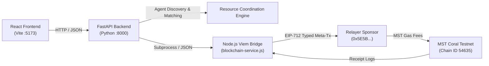
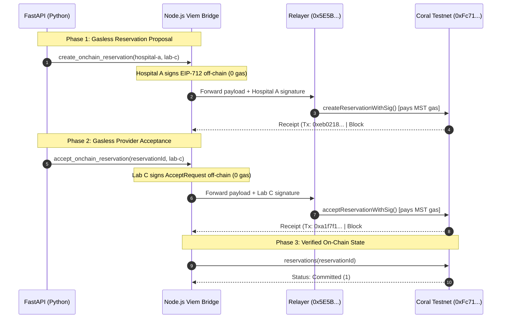

# MEDSWARM MVP Starter

An autonomous healthcare resource coordination prototype coordinating diagnostic appointment slots across healthcare institutions, backed by on-chain commitments via EIP-712 relayed meta-transactions on **MST Coral Testnet**.

---

## Architecture Overview



### Key Responsibilities
* **FastAPI (Python)**: Handles institutional resource requests, agent-driven discovery, and human-in-the-loop authorization.
* **Node.js Bridge (Viem)**: Handles EIP-712 off-chain cryptographic signatures, typed data hashing, and contract interactions without requiring Hardhat in production.
* **Relayer**: Submits meta-transactions to Coral Testnet and sponsors all network gas fees in MST.
* **Smart Contract (`MEDwayReservation.sol`)**: Enforces replay protection (nonces), expiration deadlines, state transitions, and a 7-day dispute window while preserving true institutional identities.

---

## Live On-Chain Verification Summary

The end-to-end integration is deployed, verified, and active on MST Coral Testnet.



### Confirmed Live Transaction Records

| Milestone | On-Chain Details |
| :--- | :--- |
| **Contract Deployed** | [`0xFc71e5D5b2BD0648BCA20b66a09199E8D89BBEEC`](https://coralrpc.mstblockchain.com) |
| **Network & Chain ID**| MST Coral Testnet (`54635`) |
| **Relayer (Sponsor)** | `0x5E5BB85E3f92389a75e8b555490c99af8B0e8607` |
| **Reservation ID** | `0xa550bd19b71e87ff0515504c9bf6d2d03e8a428174772650f8305acab0ac7ccf` |
| **Proposal Creation Tx** | `0xeb0218194a917781835eb24cf6774b75df9d11e086747dd43ce7c359da5bdafa` (Block **#386800**) |
| **Provider Acceptance Tx** | `0xa1f7f1874faaa9e6558015b7603699cfc4a3c14960636e7c08c4ba9911537b8b` (Block **#386823**) |
| **Requester (Hospital A)**| `0x4dB8336edB0af7FeD1311312081689993F80a18B` (Gas paid: **0 MST**) |
| **Provider (Lab C)** | `0xb05049cc2A5a1c28979DEafc82B82749681DA92C` (Gas paid: **0 MST**) |
| **Confirmed Status** | **`Committed`** (Status code: `1`) |

> **Architecture Note**: This implementation uses **EIP-712 relayed meta-transactions**, not ERC-4337 account abstraction. Participating institutions sign off-chain EIP-712 authorizations without holding or spending MST tokens, while the relayer pays the on-chain transaction gas fees.

---

## Quickstart

### 1. Environment Configuration
Copy `.env.example` to `backend/.env`:
```bash
cp .env.example backend/.env
```
Ensure `backend/.env` contains your Coral configuration and institution keys:
```env
CORAL_RPC_URL=https://coralrpc.mstblockchain.com
CHAIN_ID=54635
CONTRACT_ADDRESS=0xFc71e5D5b2BD0648BCA20b66a09199E8D89BBEEC
CORAL_PRIVATE_KEY=0x...
HOSPITAL_A_PRIVATE_KEY=0x...
LAB_C_PRIVATE_KEY=0x...
```

### 2. Run the Blockchain Service Directly
Test connectivity and relayer balance:
```bash
cd backend
node blockchain-service.js status
```

Query any on-chain reservation:
```bash
node blockchain-service.js get --reservationId 0xa550bd19b71e87ff0515504c9bf6d2d03e8a428174772650f8305acab0ac7ccf
```

### 3. Run Contract Automated Tests
Execute the full test suite (Solidity fuzz tests + TypeScript integration tests):
```bash
cd contracts
npx hardhat test
```
*(62 tests passing, covering deployment, authorization, cancellation, expiry, disputes, and EIP-712 meta-transactions).*

### 4. Run the Backend API
```bash
cd backend
# Windows:
.\.venv\Scripts\uvicorn app.main:app --reload
# macOS/Linux:
source .venv/bin/activate && uvicorn app.main:app --reload
```
Interactive Swagger docs: [http://127.0.0.1:8000/docs](http://127.0.0.1:8000/docs)

### 5. Run the Frontend Dashboard
```bash
cd frontend
npm install
npm run dev
```

---

## Important Safety & Privacy Rules
* **Patient Privacy**: All patient details and clinical records stay strictly off-chain. Only pseudonymous `resourceRef` hashes and institution addresses are recorded on Coral Testnet.
* **Authorization Gate**: AI agents discover and recommend capacity allocations, but cannot independently authorize reservations without human institutional sign-off.
* **Dispute Period**: Completed allocations enter a 7-day dispute window where either party can initiate dispute resolution with evidence before final settlement.
